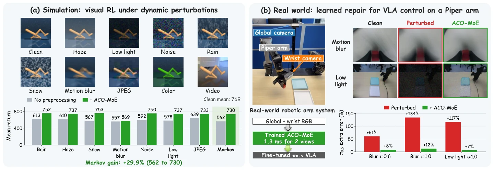
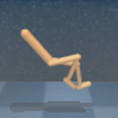
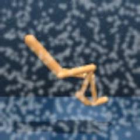
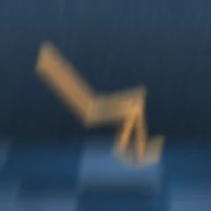
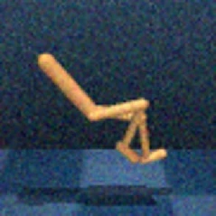
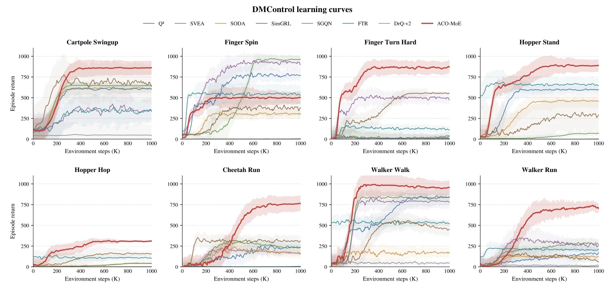
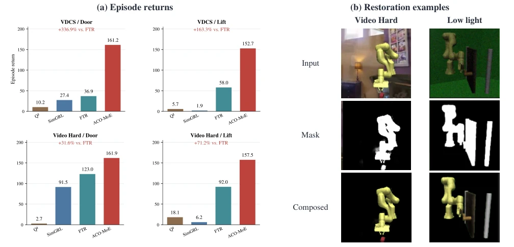
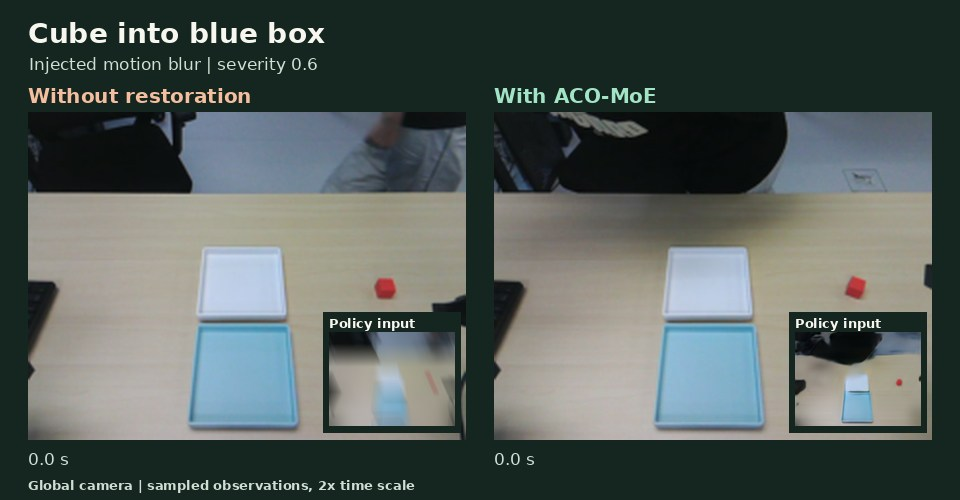
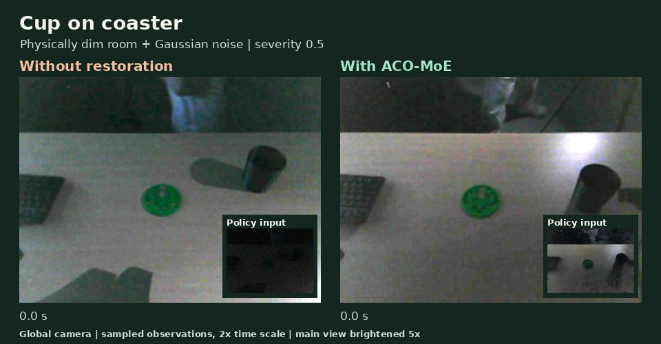

<h1 align="center">ACO-MoE</h1>

<p align="center"><strong>Agent-Centric Observation Adaptation for Robust Visual Control under Dynamic Perturbations</strong></p>

<p align="center">
  <a href="https://aco-moe.github.io/"></a>
  <a href="https://arxiv.org/abs/2604.24661"></a>
  <a href="https://aco-moe.github.io/#robot"></a>
</p>

<p align="center"></p>

## 🧩 Overview

ACO-MoE trains a mixture of repair experts to restore degraded camera observations and compose task-relevant foregrounds for visual control. This repository provides the DreamerV3 simulation pipeline, from generating paired data and training the adapter to evaluating on VDCS and DMC-GB.

| Benchmark | What it evaluates |
| --- | --- |
| **VDCS** | Visual control under seven degradation families: rain, fog, snow, blur, noise, low light, and JPEG compression. The Markov protocol switches degradations within an episode. |
| **DMC-GB** | Visual control under color changes and video backgrounds, with scripts for `color_hard` and `video_hard`. |

## 🌦️ VDCS visual degradations

Walker Run frames from the [interactive degradation gallery](https://aco-moe.github.io/#vdcs).

| Clean reference | Rain | Fog | Snow |
| :---: | :---: | :---: | :---: |
|  |  |  |  |

| Motion blur | Noise | Low light | JPEG compression |
| :---: | :---: | :---: | :---: |
|  |  |  |  |

## 📊 Simulation results

| Benchmark | Reference method | Reference mean return | ACO-MoE mean return |
| :--- | :--- | ---: | ---: |
| VDCS Markov switching | No preprocessing | 562.0 | **730.0** |
| DMC-GB Video Hard | FTR | 761.6 | **797.4** |
| DMC-GB Color Hard | SMG | 696.6 | **806.0** |

On eight VDCS tasks, DreamerV3's clean reference is 769. ACO-MoE recovers **81.2% of the return lost to Markov switching**. See the [full comparisons, per-task results, and ablations](https://aco-moe.github.io/#simulation).

<details>
<summary>VDCS learning curves and RoboSuite results</summary>





</details>

## 🎬 Real-robot experiments

Closed-loop Piper trials with a fine-tuned π₀.₅ policy. The table pools the blue-box and cup-placement tasks.

| Perturbation | Without restoration | With ACO-MoE |
| :--- | ---: | ---: |
| Injected motion blur | 3/40 | **35/40** |
| Physically dim room + Gaussian noise | 0/40 | **33/40** |

| Injected motion blur · cube into blue box | Physically dim room + Gaussian noise · cup on coaster |
| :---: | :---: |
| [](https://aco-moe.github.io/assets/blue-blur.mp4) | [](https://aco-moe.github.io/assets/cup-dim.mp4) |
| [▶ Watch comparison](https://aco-moe.github.io/assets/blue-blur.mp4) | [▶ Watch comparison](https://aco-moe.github.io/assets/cup-dim.mp4) |

[Explore all paired clips](https://aco-moe.github.io/#robot) · [Watch a continuous cup-placement rollout under stronger motion blur](https://aco-moe.github.io/#demos)


## 📁 Repository layout

```
aco-moe-code/
├── aco_moe/                 # Adapter network
│   ├── moe_unet.py          # DualStreamMoEUNet (shared encoder, router, N_e experts)
│   └── simple_unet.py       # Optional standalone U-Net expert
├── envs/                    # Environment wrappers
│   ├── dmc.py               # Vanilla DMC
│   ├── dmcgb.py             # DMC-GB color/video distributions
│   ├── dcs.py               # Distracting Control Suite (used by VDCS option)
│   ├── visual_degradations.py        # Operator family: rain, fog, snow, blur, noise, low light, JPEG
│   ├── visual_degraded_control.py    # VDCS env (Markov / sequential composition)
│   └── wrappers.py
├── scripts/                 # Entry points and shell wrappers
│   ├── generate_vdcs_dataset.py      # Step 1: build the offline H5 dataset
│   ├── train_aco_moe.py              # Step 2: pretrain ACO-MoE
│   ├── run_generate_dataset.sh
│   ├── run_train_aco_moe.sh
│   ├── run_train_dreamer_clean.sh    # Step 3: clean DreamerV3 training
│   ├── run_eval_vdcs.sh              # Step 4a: VDCS Markov-temporal eval
│   ├── run_eval_dmcgb_color_hard.sh  # Step 4b: DMC-GB color_hard eval
│   └── run_eval_dmcgb_video_hard.sh  # Step 4c: DMC-GB video_hard eval
├── dreamer.py               # DreamerV3 entry point
├── models.py networks.py tools.py parallel.py exploration.py
├── configs.yaml             # Default + adapter configs
├── requirements.txt
└── LICENSE
```

## ⚙️ Installation

```bash
python -m venv .venv
source .venv/bin/activate
pip install --upgrade pip
pip install -r requirements.txt
```

If you do not have a system X server, render with EGL:

```bash
export MUJOCO_GL=egl
```

For DMC-GB `video_hard`, download the
[DAVIS 2017 dataset](https://davischallenge.org/davis2017/code.html) (480p JPEG frames)
and pass `DAVIS_PATH=/path/to/DAVIS`.

## 🚀 End-to-end pipeline

```
[1] Generate VDCS H5 dataset
        ↓
[2] Pretrain ACO-MoE adapter (no corruption-label supervision)
        ↓
[3] Train DreamerV3 on clean DMC
        ↓
[4] Evaluate DreamerV3 with ACO-MoE observation repair
    on VDCS Markov-temporal / DMC-GB color_hard / DMC-GB video_hard
```

### 1. Generate the VDCS H5 dataset

Paired (clean, corrupted, foreground-only, mask) samples for each of the seven physical
degradations. Foreground masks are derived from MuJoCo geometry segmentation — no manual
or SAM annotation required.

```bash
bash scripts/run_generate_dataset.sh
# → data/h5/<task>_vdcs_seg64_split/{train,val}/<degradation>/*.h5
```

```bash
TASKS=walker_walk,cheetah_run \
SAMPLES=500 \
OUT_DIR=data/h5 \
bash scripts/run_generate_dataset.sh
```

### 2. Pretrain ACO-MoE (label-free)

The router is trained end-to-end through the soft expert mixture with **no corruption-label
supervision** and **no corruption-count prior**.

```bash
bash scripts/run_train_aco_moe.sh
# → checkpoints/aco_moe/moe_unet_best.pth
```

```bash
TASKS="walker_walk cheetah_run" \
STEPS=5000 \
BATCH_SIZE=32 \
bash scripts/run_train_aco_moe.sh
```

To reproduce the *supervised-router* ablation, pass `--use_label_supervision`:

```bash
bash scripts/run_train_aco_moe.sh --use_label_supervision
```

### 3. Train DreamerV3 on clean DMC

```bash
TASK=dmc_walker_walk \
LOGDIR=logdir/clean/dmc_walker_walk \
bash scripts/run_train_dreamer_clean.sh
```

### 4a. VDCS Markov-temporal evaluation

```bash
TASK=dmc_walker_walk \
ADAPTER_CKPT=checkpoints/aco_moe/moe_unet_best.pth \
EVAL_EPISODES=10 \
bash scripts/run_eval_vdcs.sh
```

### 4b. DMC-GB `color_hard`

```bash
TASK_DMC=walker_walk \
ADAPTER_CKPT=checkpoints/aco_moe/moe_unet_best.pth \
bash scripts/run_eval_dmcgb_color_hard.sh
```

### 4c. DMC-GB `video_hard`

```bash
TASK_DMC=walker_walk \
ADAPTER_CKPT=checkpoints/aco_moe/moe_unet_best.pth \
DAVIS_PATH=/path/to/DAVIS \
bash scripts/run_eval_dmcgb_video_hard.sh
```

## 🎛️ Router training

By default, the router learns from the repair objective without corruption-type labels or a corruption-count prior.

| Stage | Input to adapter | Labels consumed? |
|---|---|---|
| Adapter pretraining | corrupted RGB only | **No** |
| Loss computation | clean RGB, foreground-only RGB, mask (geometric) | **No corruption labels** |
| Inference inside DreamerV3 | corrupted RGB only | **No** |

Enforced at three points in code:

1. **`aco_moe/moe_unet.py`** — forward signature requires only `degraded`; `degradation_ids` and `teacher_force_router` are ablation-only arguments never invoked on the default path.
2. **`scripts/train_aco_moe.py`** — `_model_forward(...)` calls `model(degraded, router_topk=...)` without `degradation_ids` unless `--use_label_supervision` is explicitly passed. The router cross-entropy loss is not computed at all in the default mode.
3. **`models.py`** — the adapter is invoked as `unet(x, task_ids=task_ids)` with no `degradation_ids` argument; corruption-type information cannot leak on this path.

Dataset and training details:

- **`num_experts` is a capacity hyperparameter**, not the corruption-type count. `num_experts=4` or `num_experts=12` are equally valid.
- **Foreground masks are not human/SAM annotations.** They come from MuJoCo's geometric segmentation buffer and carry no information about the active corruption.
- **`deg_meta` is audit metadata only.** The degradation-name string attached per sample is never returned to the training loader or fed to the model.

## 🔍 Adapter inference

For each corrupted frame `x_t ∈ [-1, 1]`, ACO-MoE predicts:

- RGB residual: `Δ_t = Σ_j π_{t,j} · Δ_t^(j)` mixed across `N_e` experts
- Foreground map: `m_t ∈ [0, 1]^{H × W}`

and composes the agent-centric observation:

```
x̃_t = ô_t · m_t + b · (1 − m_t)
ô_t = clip(x_t + tanh(Δ_t), −1, 1),  b = −1
```

No corruption labels, clean reference frames, or simulator masks are required at inference.
Hard top-1 routing is used during evaluation.

## Configurations

| Config | Purpose |
|---|---|
| `dmc_vision` | Clean DreamerV3 training on DMC |
| `adapt_vdcs_markov_temporal` | VDCS Markov-temporal eval + ACO-MoE |
| `adapt_dmcgb_color_hard` | DMC-GB `color_hard` eval + ACO-MoE |
| `adapt_dmcgb_video_hard` | DMC-GB `video_hard` eval + ACO-MoE |
| `debug` | Smoke testing |

Combine on the CLI: `--configs dmc_vision adapt_vdcs_markov_temporal`.

## 🧪 Quick smoke test

```bash
python -c "
import torch
from aco_moe.moe_unet import DualStreamMoEUNet
m = DualStreamMoEUNet(num_experts=7)
x = torch.randn(2, 3, 64, 64).clamp(-1, 1)
out = m(x)
for k, v in out.items():
    print(k, tuple(v.shape))
"
```

```bash
MUJOCO_GL=egl python dreamer.py --configs dmc_vision debug \
    --task dmc_walker_walk --logdir logdir/smoke --steps 200
```

## 📚 Citation

If you use ACO-MoE or VDCS in your research, please cite:

```bibtex
@misc{fang2026agentcentricobservationadaptationrobust,
      title={Agent-Centric Observation Adaptation for Robust Visual Control under Dynamic Perturbations},
      author={Zhengru Fang and Yu Guo and Huanhuan Lou and Fei Liu and Yuang Zhang and Yihang Tao and Senkang Hu and Wenbo Ding and Yuguang Fang},
      year={2026},
      eprint={2604.24661},
      archivePrefix={arXiv},
      primaryClass={cs.RO},
      url={https://arxiv.org/abs/2604.24661},
}
```

## 📄 License

MIT (see `LICENSE`). The DreamerV3 backbone is adapted from the publicly available
DreamerV3 codebase under the same license.
